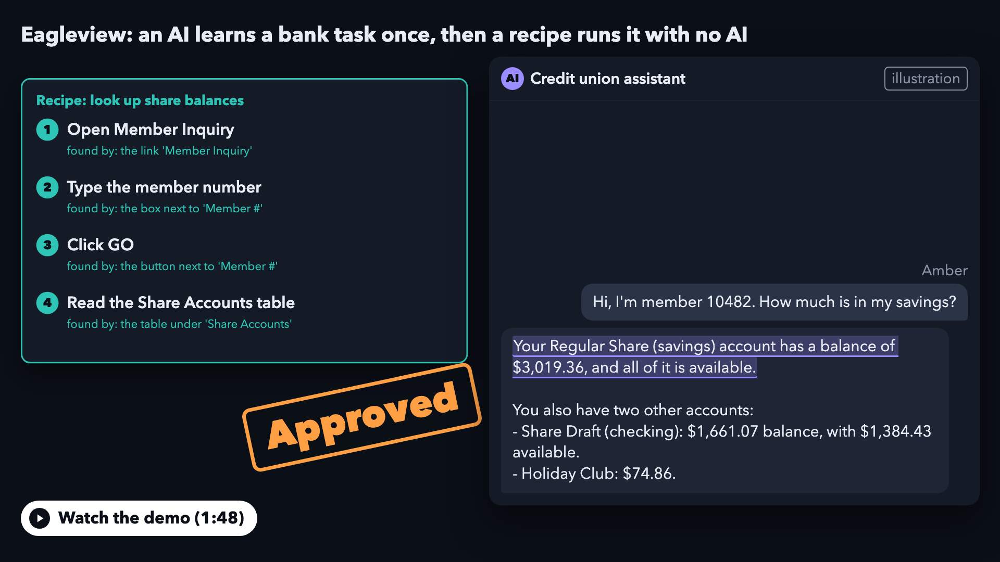

# Eagleview

**Teach an AI to navigate software once. Turn what it learns into a program that runs without AI.**

[](evidence/demo.mp4)

## The idea

Imagine a bank has a piece of software that's been running for 30 years. It works, but there's no API. To retrieve an account balance, someone has to open the application, find the right menu, enter a member number, and read what's on the screen.

An AI agent can do this. Give it access to the screen and it can figure out where to click, what to type, and how to find the answer.

But there's an interesting question here: **if the agent has already figured out how to perform a task, why should it have to figure it out again?**

Most of the work is in discovering the sequence of actions. Once that sequence is known, executing it shouldn't require a language model.

That's the idea behind Eagleview.

## How it works

Eagleview separates discovering a workflow from executing it.

1. **Discover.** Give an AI agent a task. It explores the application, interacts with the interface, and works out how to accomplish it.
2. **Compile.** Eagleview turns the successful interaction into a reusable *capability*: a sequence of actions with defined inputs, expected screen states, and outputs.
3. **Approve.** A human reviews the capability before it can run unattended.
4. **Replay.** The capability can now execute with different inputs, without making another AI call.

For example, an agent might discover how to look up a member's share balances. Once approved, that capability can retrieve balances for other members without rediscovering the interface each time.

The important distinction is that **AI is used to discover the procedure, not to execute it repeatedly.**

And because these procedures are exposed as tools, another AI assistant can invoke them without needing direct control of the underlying application.

## What happens when something goes wrong?

A recorded sequence of clicks isn't enough. Real applications have expired sessions, unexpected dialogs, missing records, and actions that cannot safely be repeated.

Eagleview handles these as part of execution:

- **Screen verification.** Each action checks that the application is in the expected state before continuing.
- **Recovery.** Known interruptions, such as session expiry or familiar dialogs, can be handled automatically.
- **Human takeover.** When the application behaves unexpectedly, execution pauses. A person can take control of the same session and hand it back.
- **Irreversible actions.** Operations such as posting an account require explicit approval. If the outcome is uncertain, Eagleview stops rather than risk performing the action twice.
- **Privacy.** Sensitive information is redacted from stored screenshots and execution logs.

A missing member is a valid result, not necessarily a failed execution. An unexpected screen, on the other hand, is a reason to stop.

That distinction matters when software is making decisions around financial records.

## What we've tested

Eagleview was tested against a simulated banking system with two credit unions, including variations in their interfaces.

| Measurement | Result |
|---|---|
| AI cost to discover a task | ~$0.05–$0.07 |
| Subsequent execution | 1.3–1.7 seconds |
| AI calls during replay | 0 |
| Repeatability | 20/20 successful runs |
| Automated tests | 690 |
| Evidence scenarios | 17 |

These scenarios cover successful lookups, missing records, invalid inputs, unexpected dialogs, session recovery, human intervention, uncertain transactions, and reuse across different credit unions.

The underlying run evidence is documented in [evidence/](evidence/README.md).

## Try it

Requires Python 3.12 and [uv](https://docs.astral.sh/uv/).

```bash
uv sync
uv run playwright install chromium
make demo-offline
```

This launches the simulated banking application, executes the saved capabilities against ten scenarios, verifies the outcomes, and shuts everything down.

No API key required.

To let an AI discover a workflow itself, add an Anthropic API key to `.env`, then:

```bash
make bank
```

In another terminal:

```bash
uv run eagleview discover --goal "Look up member 10482 and read their share balances."
```

Replay the generated capability without AI:

```bash
uv run eagleview replay <capability-path> --input member_id=10482
```

To experiment with human takeover:

```bash
make demo-handoff
```

Open `http://127.0.0.1:8700` to take control of a paused execution and return it to the automation.

## Under the hood

Eagleview uses Playwright to interact with the application, but replay is more than a Playwright script.

Each capability contains the information needed to locate controls, verify expected states, handle known outcomes, and decide when execution must stop.

Controls are identified through multiple signals, including accessibility names, nearby labels, text, and DOM structure. Ambiguous matches are rejected rather than guessed.

All interactions pass through a shared safety layer, whether initiated by the discovering agent, an approved capability, or a human operator.

The replay engine is deliberately independent of the language model. A test enforces that separation.

For the architecture, failure cases, design decisions, and limitations, see [REPORT.md](REPORT.md).

## License

MIT — [LICENSE](LICENSE).
